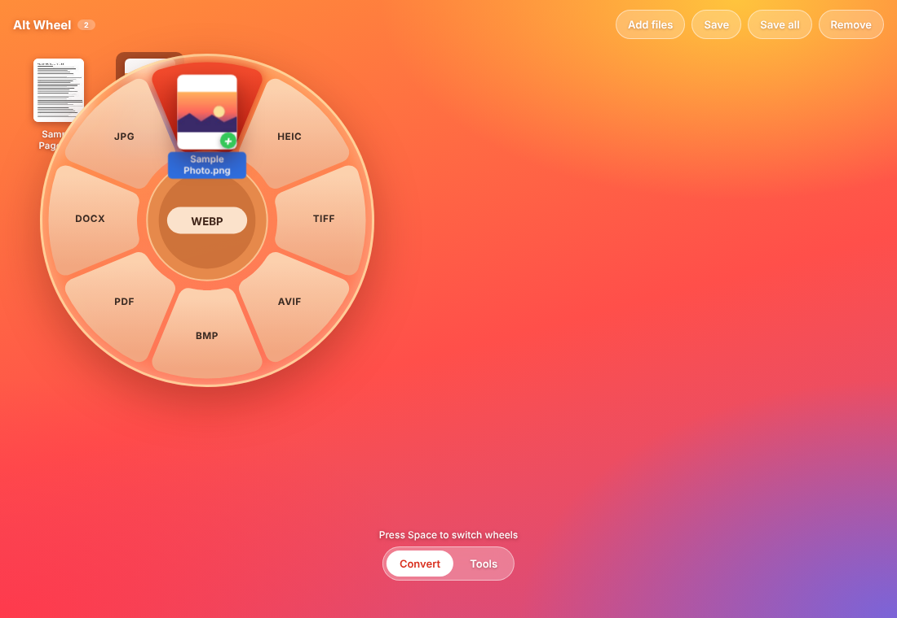
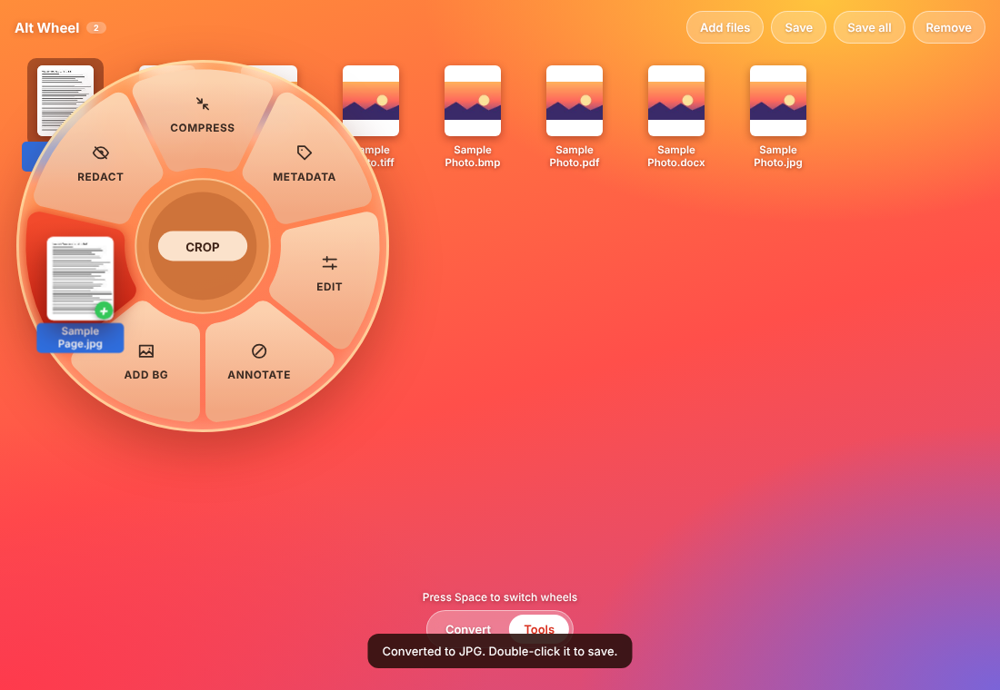
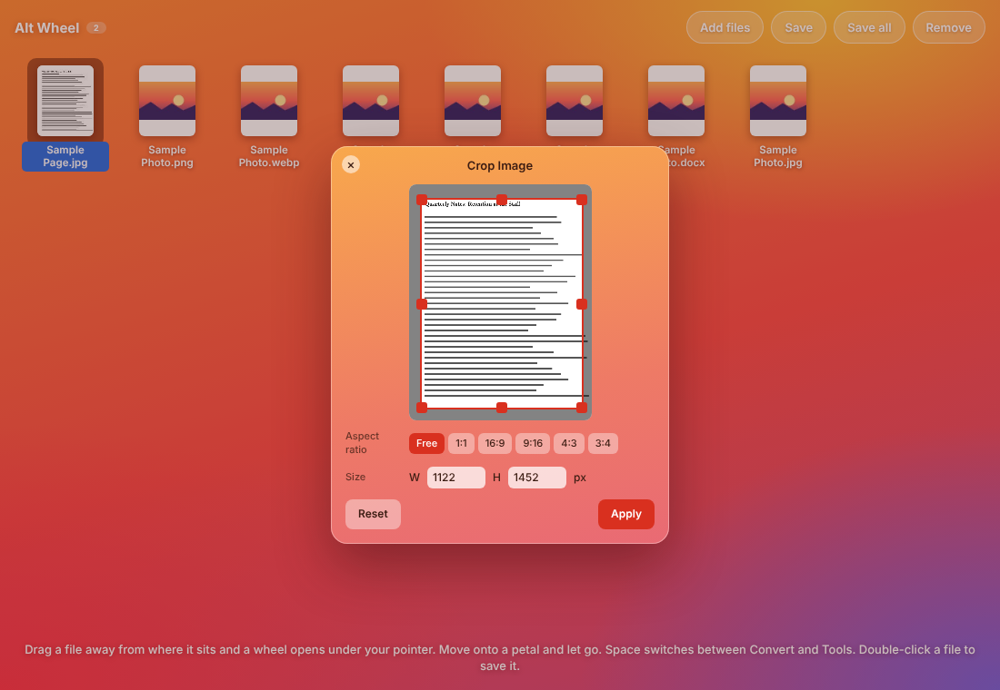

<div align="center">


# Alt Wheel 2

*The second version of Alt Wheel.*<br>
**Drag a file. A wheel opens under your pointer. Drop it on a petal.**<br>
Convert images and PDFs, or crop, compress, annotate and redact them. All in your browser.

[](https://joelhere17.github.io/Alt-Wheel/)
[](LICENSE)




</div>

## Features

- **Radial wheel** that opens wherever you start dragging, with a glass look and a pop-in animation.
- **Convert wheel:** PNG, WEBP, HEIC, TIFF, AVIF, BMP, PDF, DOCX, JPG and TXT, depending on the file you drag.
- **Tools wheel:** Compress, Metadata, Edit, Annotate, Add BG, Crop and Redact.
- **Switch wheels mid-drag** with Space (or Tab, Shift, or by moving onto the Convert/Tools pill).
- **Open** images, HEIC photos, TIFF, BMP, AVIF and PDFs. Add files with the button or drag them in from your computer.
- **Save** one file, or **Save all** as a zip.
- **Private.** Nothing is uploaded. Files are processed on your own device.
- **No build step.** Plain HTML, CSS and JavaScript.

<div align="center">


</div>

## Quick start

**Use it online:** https://joelhere17.github.io/Alt-Wheel/

**Run it locally:**

```bash
git clone https://github.com/joelhere17/Alt-Wheel.git
cd Alt-Wheel
# then double-click index.html, or:
python -m http.server 8000     # visit http://localhost:8000
```

## How to use

1. Click **Add files** (or drag files in). Two sample files are there to try.
2. Press on a file and drag it away from its spot. The wheel opens under your pointer.
3. Move onto a petal until it turns red. Press **Space** to flip between Convert and Tools.
4. Let go. A converted file appears next to the original, or a tool window opens.
5. Double-click any file to save it, or select it and press **Save**.

## Supported formats

| Source | Can become |
| --- | --- |
| JPG, PNG, WEBP, GIF, BMP, TIFF, AVIF, HEIC | PNG, WEBP, HEIC, TIFF, AVIF, BMP, PDF, DOCX, JPG (not itself) |
| PDF | DOCX, JPG, PNG, TXT |

Limits worth knowing:

- Browsers cannot write HEIC, so picking the HEIC petal shows an error message. AVIF output only works in browsers that can encode it, and shows an error message otherwise.
- PDF to DOCX and TXT use the text found in the PDF. Scanned PDFs without text produce little or nothing.
- PDF, DOCX, TIFF and BMP output place your picture in that file type. Very large images (over about 24 megapixels) are refused to protect memory.

## Project structure

```
Alt-Wheel/
├── index.html           page and script list
├── css/                 base, wheel, modals, responsive
├── js/
│   ├── core/            config, canvas helpers, encoders, EXIF
│   ├── app/             files, convert, wheel, drag, input
│   ├── tools/           crop, background, compress, metadata, edit, markup
│   └── main.js          starts the app
├── assets/              favicon and screenshots
├── tests/e2e.py         Playwright end-to-end test
└── docs/ARCHITECTURE.md how it works, how to extend it
```

More detail, including how to add a format or a tool, is in [docs/ARCHITECTURE.md](docs/ARCHITECTURE.md).

## Customize

- **Colors:** edit the `:root` list at the top of `css/base.css`.
- **Wheel size and shape:** the constants at the top of `js/app/wheel.js` (`RIN`, `ROUT`, `GAP`, `RC`).
- **Tool petals and icons:** `TOOLS` and `ICONS` in `js/app/wheel.js`.
- **Convert petals:** `IMG_OUT` and `convertTargets()` in `js/app/convert.js`.

## Host your own copy

1. Fork this repository, or create a new public one and upload these files.
2. Go to **Settings > Pages**.
3. Set **Source** to **Deploy from a branch**, pick `main` and `/ (root)`, and save.
4. After a minute your site is live at `https://YOUR-USERNAME.github.io/REPO-NAME/`.

## Testing

```bash
pip install playwright
playwright install chromium
python tests/e2e.py
```

The test opens the app, drags files onto every petal of both wheels, runs each tool, and saves every result.

## Tech notes

- Pointer Events with pointer capture for dragging, SVG for the wheel, canvas for all image work.
- BMP, TIFF, PDF, DOCX and ZIP files are written by small hand-made encoders in `js/core/encoders.js`.
- [pdf.js](https://mozilla.github.io/pdf.js/) and [heic2any](https://github.com/alexcorvi/heic2any) load from a CDN only when you open a PDF or HEIC file.

## Contributing

Pull requests are welcome. See [CONTRIBUTING.md](CONTRIBUTING.md).

## License

[MIT](LICENSE) © 2026 joelhere17
